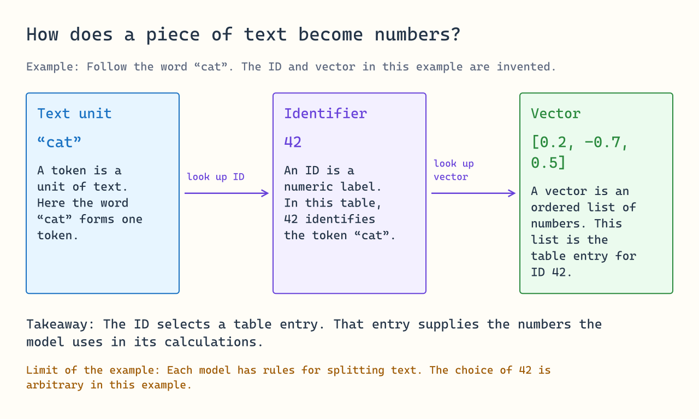

# Explain by Drawing

Ask a question and get an editable drawing with a short guide. The skill can create a diagram, update a board you already have, or walk you through an existing drawing. It uses the language of your question for both the labels and the explanation.



## Install and try it

1. [Download the current project ZIP](https://github.com/mattcsilva/explain-by-drawing/archive/refs/heads/main.zip) and extract it, or clone this repository.
2. Copy the entire `skills/explain-by-drawing/` folder into a skills directory your agent reads. Keep the `SKILL.md`, license, references, scripts and examples together.
3. Open the project in your agent. Give it a folder where it can save the drawing and try the prompt below.

> Why does a diagonal divide even a narrow rectangle into two equal areas? Show me with a drawing and a short guide. Save it as diagonal.svg.

For OpenCode, choose the installation location that fits how you work.

| Install for | Destination |
| --- | --- |
| One project | `<project>/.opencode/skills/explain-by-drawing/` |
| All your projects | `~/.config/opencode/skills/explain-by-drawing/` |

This folder follows the Agent Skills format. Automatic selection was tested in OpenCode with DeepSeek V4.1 Flash Free. In another compatible agent, use its documented skills directory. You can also request the skill by name, as in “Use explain-by-drawing to explain how a cache hit works.” [Agent Skills specification](https://agentskills.io/specification) · [OpenCode installation paths](https://opencode.ai/docs/skills/)

## What you need

| What you want to do | What you need |
| --- | --- |
| Create a standalone SVG | An agent that can read the skill and write the file. A browser or SVG viewer can display it. |
| Edit an existing drawing | The current drawing and write access to that file. The agent asks for the original when it cannot locate it. |
| Run the included layout generator | Node.js 18 or later. The generator works offline and uses only the standard library. |
| Edit boards directly in Obsidian | Your vault, the Excalidraw plugin and the Obsidian CLI enabled for the running app. [Integration guide](skills/explain-by-drawing/references/obsidian-excalidraw.md) |

## Run a worked example

From the repository root, run the following command with a new output directory.

```sh
node skills/explain-by-drawing/scripts/draw.cjs skills/explain-by-drawing/assets/examples/01-sequence.json token-board
```

Open `token-board/board.svg` in a browser. To move the shapes and labels yourself, open `token-board/board.excalidraw` in Excalidraw. The worked examples also cover a revision cycle, a comparison and a round trip between two machines. [Worked examples](skills/explain-by-drawing/references/worked-examples.md) · [Layout components](skills/explain-by-drawing/references/components.md) · [Lesson planning](skills/explain-by-drawing/references/lesson-plan-and-review.md)

## Optional study memory

To resume a lesson across chats, copy `optional/continuous-study/` alongside `explain-by-drawing/`. Give the agent the path to your Obsidian vault and permission to maintain the relevant study notes. The optional helper that snapshots notes before an edit requires Python 3.9 or later. [Study memory instructions](optional/continuous-study/SKILL.md)

## Contributing

For a drawing or activation issue, include the prompt, the agent and model you used, and what you expected to see. A small example with invented data makes it easier to reproduce the problem. To check a change to the generator, run the following command and inspect the affected drawing at reading size.

```sh
node skills/explain-by-drawing/scripts/verify.cjs
```

## License

The skills, scripts and examples are distributed under the [MIT License](LICENSE).
